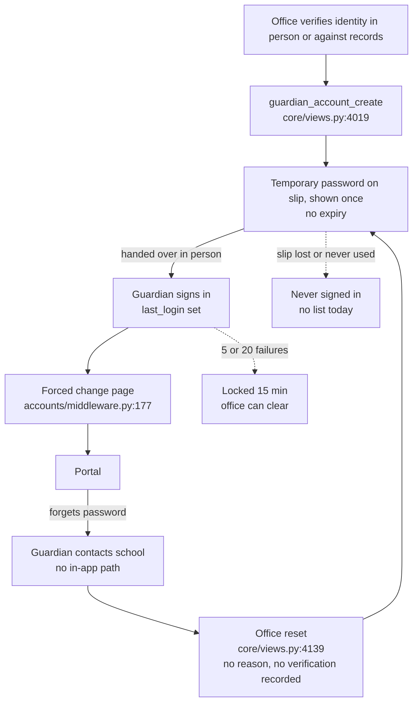

# G-06 Phase 0: guardian access, current state

- **Status:** research, docs only. Not a spec and not approved for build.
- **Baseline:** `origin/main` c6aad3d. Every `path:line` below is on that tree.
- **Gap:** G-06 (GUA-01 activation and recovery, ANA-05 guardian account inactive), the last open P1 gap
  (`PACKAGE_C_CLOSEOUT.md` §7, `OPTION_A_B_BENCHMARK_CLOSEOUT.md` §2.4, §4).
- **Companion documents:** [G06_RECOVERY_THREAT_MODEL.md](G06_RECOVERY_THREAT_MODEL.md),
  [ADR 0029 (Accepted)](../adr/0029-guardian-account-recovery.md),
  [G06_NEVER_SIGNED_IN_SPEC.md](G06_NEVER_SIGNED_IN_SPEC.md).
- **Not found:** the brief cited `docs/audits/modern-web-05-login-password.md`. There is no `docs/audits/`
  directory and no file with that name on this tree, so it was not used.

## 1. Governing decisions

| Source | What it says |
| --- | --- |
| ADR 0013, "Identity and provisioning" | No self-registration and no self-service password recovery in Phase 6. Only an administrator creates a guardian account, after verifying identity. Temporary password shown once, forced change at first login. Reset is an administrator action that ends every session. |
| ADR 0013, "Alternatives rejected" | Guardian email or phone as login is rejected: "would create a reset channel the institution does not operate". |
| ADR 0013, "Sessions" | `session_version` in the session hash; 30-minute idle and 8-hour absolute limits; forced-change allow-list. |
| ADR 0015 | Messaging needs recorded opt-in per guardian per channel. Gate 1 offers only PORTAL_ONLY and ASSIST (click-to-chat from the school's own WhatsApp). |
| `docs/PHASE_7_COMMUNICATION_DOCUMENTS_IMPORT_PLAN.md:101` | SMS and email delivery are out of scope for Phase 7. |
| `docs/REQUIREMENTS.md:485`, `docs/PHASE_6_GUARDIAN_PORTAL_PLAN.md:106` | Self-service password recovery, email and SMS delivery excluded. |
| `OPTION_B_IMPLEMENTATION_SPEC.md` §9.3 | A self-service recovery design opens only if the overall sign-in failure rate G ≥ 20% **and** the office confirms resets are a recurring burden. Measurement is off by default (ADR 0027), so G has no data yet. |

Any self-service recovery therefore reverses a frozen part of ADR 0013 and needs its own accepted ADR.

## 2. Current workflows

### 2.1 Activation (office creates the account)

1. A Guardian record exists with optional `phone` and `email` (`core/models.py:531-533`). An administrator
   opens the guardian profile (`core/views.py:3628-3673`).
2. `guardian_account_create` (`core/views.py:4019-4054`, permission `core.add_guardianaccount`) takes a
   username, a verification method and a required note. Methods: in person with documents, against school
   records, other (`core/models.py:3509-3512`). The note cannot be blank (`core/models.py:3561-3564`).
3. `create_guardian_account` (`core/guardian_accounts.py:125-147`) creates the `User` with a generated
   temporary password, sets `must_change_password`, creates the `GuardianAccount` and records
   `ACCOUNT_CREATED` (HISTORY class).
4. The password is 12 characters from a 31-character alphabet without look-alikes, grouped 4-4-4
   (`core/guardian_accounts.py:28`, `:63-66`), about 59 bits.
5. `_credential_slip` (`core/views.py:4007-4016`) renders it once with `no-store` headers. The slip tells
   staff to hand it over in person and "Do not send it by message"
   (`core/templates/core/guardian_credential_slip.html:5`). A repeated POST makes no second password
   (`core/views.py:4024-4030`).
6. Access to a child is a separate, explicit grant per relationship (`guardian_access_grant`,
   `core/views.py:4166-4191`; model `core/models.py:3575-3623`).

The temporary password has **no expiry**. A slip that is never used stays valid until the first sign-in
or the next reset. `User` has no field for when a temporary password was issued (`accounts/models.py:28-29`).

### 2.2 Sign-in

| Step | Evidence |
| --- | --- |
| Route `accounts/login/` with `ThrottledAuthenticationForm` | `config/urls.py:32-41` |
| Username normalized and compared case-insensitively; hasher runs for an unknown username to reduce timing differences | `accounts/backends.py:15-33` (`:27-30`) |
| One generic error for unknown user, wrong password, inactive login and throttled attempts | `accounts/forms.py:10`, `:15-25` |
| Throttle Rule A: 5 failures per username + source in 15 minutes. Rule B: 20 failures per username from any source. No global or per-source-only limit | `accounts/security.py:9-12`, `:26-29`, `:71-78` |
| Source stored only as an HMAC of the client address | `accounts/security.py:49-63` |
| Each attempt writes a `SecurityEvent` (succeeded, failed, throttled) with the hashed source, never the typed text | `accounts/forms.py:41-62`, `:65-71` |
| Login failures expire after 24 hours | `accounts/security.py:27`, `:66-68` |
| Session clocks start on `user_logged_in` | `accounts/middleware.py:40-44`; wired in `accounts/apps.py:15` |
| Idle 30 minutes, absolute 8 hours, enforced every request | `config/settings.py:136-137`; `accounts/middleware.py:151-176` |
| Cookies HttpOnly, SameSite=Lax, Secure under HTTPS | `config/settings.py:140-151` |
| Office view and clearing of lockouts (`clear_login_lockout`), audited as `LOCKOUT_CLEARED` | `core/urls.py:345-350`; `core/views.py:3679-3704`; `accounts/models.py:183` |

### 2.3 Forced first change and voluntary change

- While `must_change_password` is set, every request except the password-change page, sign-out, the school
  logo and the session status redirects to the change page (`accounts/middleware.py:26`, `:177-180`,
  `:198-206`).
- `PasswordChangeView` (`accounts/views.py:103-141`) clears the flag, records `PASSWORD_CHANGED`
  (`:128-139`) and keeps only the current session; other sessions stop verifying because the password hash
  changed (`accounts/models.py:44-52`).
- Validators: Django's similarity, minimum length, common and numeric validators (`config/settings.py:177-190`).

### 2.4 Office reset

- Route `guardian-accounts/<pk>/reset-password/`, permission `core.reset_guardian_password`
  (`core/urls.py:411-414`; `core/views.py:4139-4163`; `core/tests/route_permissions.json:680-687`).
- The confirm page shows the guardian name and username and asks for nothing else
  (`core/templates/core/guardian_reset_confirm.html:5-17`). **No reason and no identity-verification
  method are recorded for a reset**, unlike account creation.
- `reset_guardian_password` (`core/guardian_accounts.py:223-235`) sets a new temporary password, sets
  `must_change_password`, calls `end_all_sessions()` and records `PASSWORD_RESET_BY_ADMIN`.
- `PASSWORD_RESET_BY_ADMIN` is a ROUTINE event (`accounts/models.py:102-111`), so it may be purged after
  365 days, while `ACCOUNT_CREATED` is HISTORY and kept.
- Only logins with no other authority may be reset (`core/guardian_accounts.py:43-60`), which blocks
  privilege escalation through this route (Security Gate 1).
- The guardian is **not notified** of a reset: there is no channel (§4).

### 2.5 Sessions and invalidation

- The session hash includes `password` and `session_version` (`accounts/models.py:44-52`).
  `end_all_sessions()` bumps the version (`:54-57`).
- Deactivating a login bumps it too (`end_sessions_on_deactivation`, `accounts/apps.py:16-26`).
- Revoking a guardian account link ends its sessions (`core/guardian_accounts.py:193-205`).

### 2.6 Audit

`SecurityEvent` is append-only; triggers refuse UPDATE and refuse DELETE except ROUTINE events older than
365 days (`accounts/models.py:60-66`). It stores actor, subject, guardian and student id references, a
hashed source and a JSON `detail` (`:113-126`). The guardian profile shows HISTORY events only
(`core/views.py:3655-3658`), so resets and sign-ins do not appear there.

### 2.7 Accounts and grants

- `GuardianAccount`: one login to one Guardian, at most one active per user and per guardian, revoked
  never deleted (`core/models.py:3500-3572`). Permissions `reset_guardian_password`,
  `change_guardian_username` (`:3540-3543`).
- `GuardianStudentAccess`: explicit grant per `StudentGuardian`, one active per relationship
  (`core/models.py:3575-3623`). A guardian with several children has one login and one grant per child.
- "On the portal" means an active, non-pending grant whose guardian has an active login
  (`core/notification_producers.py:42-60`).

### 2.8 Diagram

## 3. Contact data and consent

| Data | Evidence | Verified? |
| --- | --- | --- |
| `Guardian.phone`, free text up to 50 characters, optional | `core/models.py:532`; form has no phone validation (`core/forms.py:1171-1175`) | No. No verified flag or date. |
| `Guardian.email`, optional | `core/models.py:533` | No. |
| Shared phone numbers across guardians | the duplicate check matches guardians by phone (`core/duplicate_checks.py:15-29`) | Expected for families; a phone is not a unique identity. |
| WhatsApp consent, append-only, latest row is current | `core/models.py:3900-3935`; `core/notifications.py:41-55`; office records it (`core/notification_views.py:27-41`) | Records consent to **notifications** on WhatsApp only. It is not consent to use the number for authentication. |

DPDP substantive duties apply from 13 May 2027 (ADR 0015 Context; Phase 7 plan D3).

## 4. Channels that exist

| Channel | Evidence | Usable for guardian recovery? |
| --- | --- | --- |
| Email | `mail_backend_for` sends SMTP only when `EMAIL_HOST` is set; otherwise production discards mail (`config/deployment_safety.py:31-42`; `config/settings.py:274-285`). Used for operator crash email. | No. No provider is configured, and guardian email is optional and unverified. |
| Telegram | Operator crash alert to one private chat (`config/telegram_alerts.py:1-5`: "It is not a guardian channel"). | No. |
| WhatsApp ASSIST | Staff send from the school's own phone via click-to-chat (ADR 0015). | Not for secrets: a person sends it and the text stays in the school phone's chat history. |
| WhatsApp API, SMS | Not built (ADR 0015 Gate 1 amendment; Phase 7 plan §2). | No. |

## 5. Engagement data

- `User.last_login` is Django's default field, set at every successful sign-in, including the first
  sign-in with a temporary password before the forced change.
- The admin home Parents tab counts active-login guardians and those with `last_login` this month
  (`core/home_parents.py:60-77`), shown as "Parents who logged in this month"
  (`templates/partials/home/_parents.html:31`). It also lists sections with students lacking a portal
  parent (`core/home_parents.py:80-98`). Both are aggregates.
- Teachers already have a "Last sign-in" column and "Never signed in" text (`core/teacher_views.py:35`;
  `core/templates/core/teacher_list.html:49`, `:70`). There is no guardian equivalent.

## 6. Where it hurts

These are inferences from the code and the closeouts, not measured. Measurement is off (ADR 0027), and no
office interview is recorded.

- **Office workload.** Every forgotten password is a visit or call, then a reset and a new slip. The only
  route is `core/views.py:4139`.
- **Guardians who never activate.** A lost slip has no follow-up: the office cannot list never-signed-in
  accounts, and the slip never expires.
- **Lockouts.** A guardian who guesses a few times is locked for 15 minutes and sees only the generic
  error, then has no in-app path except to contact the school.
- **Weak reset record.** No reason or verification method is captured at reset, and the event is purged
  after a year. An insider reset is hard to tell from a legitimate one later.

## 7. Gaps

| ID | Gap | Needs a recovery decision? |
| --- | --- | --- |
| P0-1 | No list of guardians who never signed in (ANA-05) | No. Spec: [G06_NEVER_SIGNED_IN_SPEC.md](G06_NEVER_SIGNED_IN_SPEC.md). |
| P0-2 | Temporary passwords never expire | Yes (Critical tier, ADR 0029) |
| P0-3 | Reset records no reason or verification method; ROUTINE retention | Yes |
| P0-4 | Account owner is not notified of a reset or password change | Yes, and needs a channel |
| P0-5 | No guardian-facing "I can't sign in" path | Yes |
| P0-6 | No verified contact data for any channel | Yes, plus provider and legal checks |
| P0-7 | Both throttle rules are keyed on the username; no cap per source across usernames and no global cap (`accounts/security.py:71-78`) | Yes, for any public recovery endpoint |
| P0-8 | Office reset does not clear a sign-in lockout (`core/guardian_accounts.py:223-235`), and throttled attempts keep extending it (`accounts/forms.py:44`). **Live bug** | No. Separate small fix PR (ADR 0029 R16) |
| P0-9 | The forced change accepts the temporary password as the new one (`config/settings.py:177-190`). **Live bug** | No. Separate small fix PR (ADR 0029 R19) |
| P0-10 | `Guardian.phone` and `email` change with no audit event (`core/views.py:3521-3532`), yet a callback relies on the phone | Yes (ADR 0029 R17, R18) |

Revision r2 (security review of PR #301): P0-7 corrected, P0-8 to P0-10 added.
